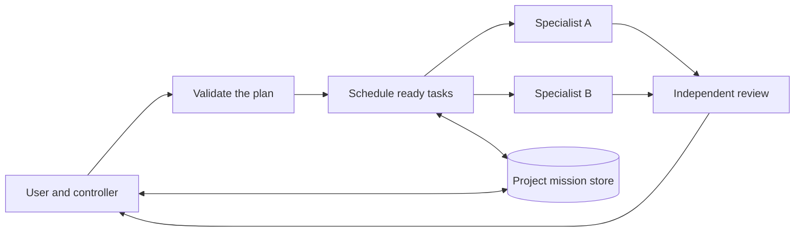

# Boardroom for DeepSeek Harness

Use `/boardroom` to bring a business request to one controller. It can answer a small question directly or assign a larger job to specialists. A request to price an offer and plan outreach can use finance and sales in the same mission. The controller tracks decisions and work in progress, so you can change direction or return to the mission in a later chat.

Boardroom runs inside [DeepSeek Harness](https://github.com/deepseek-ai/deepseek-harness). The release includes the controller, mission runtime, 22 specialist skills, and templates for your project's business records.

## Run it

1. Install Node.js 24, then clone the repository and install its pinned dependencies.

   ```sh
   git clone https://github.com/rodriguezzfabricio/boardroom-harness.git
   cd boardroom-harness
   npm ci
   ```

2. Install Chromium for website checks. On Linux, use `npx playwright install --with-deps chromium` if system libraries are missing.

   ```sh
   npm run browser:install
   ```

3. Start Harness with Boardroom enabled for a project. Replace the path with an existing project or a new directory for the demo.

   ```sh
   npm start -- --project ../boardroom-demo
   ```

4. In the Harness browser UI, configure your model credentials under **Models**. Open a new chat with the configured project as its working directory. Enter `/boardroom` and try the [finance and sales example](examples/first-mission.md).

The launcher uses Harness **0.2.0-rc.2** from the lockfile and creates a `boardroom` web profile on first use. Repeat `--project` for multiple folders. For an existing compatible profile, a manual overlay, or a setup check, see [installation and troubleshooting](docs/installation.md).

## What happens during a mission



- Plans bind work to 16 capabilities across website, finance, strategy, sales, marketing, product, operations, legal, analytics, and research. The scheduler starts independent tasks in parallel.
- Workers get their assigned skill instructions, a limited tool list, and relevant evidence. The reviewer can read the full reports before making a recommendation.
- Corrections update the mission revision and invalidate affected work. The controller can resume compatible results from SQLite after a restart.
- Website delivery uses a separate mission workspace. Browser checks can click, fill, and assert the result of a declared journey at desktop and mobile sizes.
- Accepting a deliverable and adopting a business decision are separate actions. A new decision on the same topic can supersede the old one.

See [architecture and runtime limits](docs/architecture.md) for task scheduling, model routing, permissions, and state. See [tests and verification](docs/verification.md) for the checks you can run without model credentials.

## Scope

Live missions use your configured model provider and its billing. Web research needs Harness web tools and any credentials they require. Website checks cover the local page and the interactions you specify. External connectors, deployment, voice, and a production backend are outside this release.

Boardroom code is [MIT licensed](LICENSE). Bundled specialist skills retain their upstream licenses and attribution. [Skill sources and notices](THIRD_PARTY_NOTICES.md).
