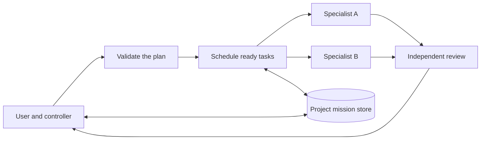

# Boardroom

Boardroom is an agent team for business work, running inside [DeepSeek Harness](https://github.com/deepseek-ai/deepseek-harness). You type `/boardroom`, describe an outcome the way you would describe it to a colleague, and it plans the job, hands the parts to specialist workers, has someone else check the result, and saves the mission inside your project. Come back the next day and the numbers and decisions are still there.

It runs on your machine with your own model credentials. The test suite runs offline, without a model at all.

## The problem it solves

Ask a chat assistant to price a new offer and you get one reply from one model. The work behind that reply is usually three jobs wearing one hat: checking unit economics, working out whether sales can really close at that price, and writing the page that sells it. Each needs different instructions and different tools, and the arithmetic needs a second pair of eyes before anyone acts on it.

What usually happens instead:

- One model produces everything, so the finance opinion and the sales opinion have no independent basis.
- Nobody checks the maths. A wrong break-even number reads exactly as confident as a right one.
- The figures live in the transcript. Close the tab, or start a new chat, and the assumptions are gone.
- "Change fixed cost to 900" means starting over, because nothing tracks which earlier work the change invalidates.

Boardroom treats that as a scheduling and state problem. A request becomes a mission with named outcomes. A planner binds each outcome to a capability, a scheduler runs the independent parts at the same time, a reviewer reads the full reports, and every result is tied to the mission revision it was produced under.

## What is in the box

| | |
| --- | --- |
| Controller | One skill, `/boardroom`, that answers small questions directly and plans larger work |
| Capabilities | 21 declared capabilities across website, finance, strategy, sales, marketing, product, operations, legal, analytics and research |
| Specialists | 26 skill files, each with its own instructions, references and in some cases scripts |
| Runtime | Planner, scheduler, reviewer, mission store, evidence store and workspace, about 2,800 lines of ESM |
| Templates | `COMPANY.md`, `STATE.md` and `DECISIONS.md` for the project's business records |
| Tests | 127 checks that run without credentials |

A few capabilities, concretely: `website-implement` writes a local page and runs a browser check against it. `financial-analysis` computes margins and scenarios from figures you supply. `tax-preparation` researches registration rules, builds a deadline calendar and assembles an accountant handoff. `market-research` reads primary sources and keeps the passages it used.

## How a mission runs



1. You describe the outcome. The controller asks for what it is missing, then proposes a plan that covers every outcome you asked for.
2. The plan is validated before any work starts: outcome coverage, dependency order, who is allowed to write files, and whether a final review is present.
3. Ready tasks start together, up to the concurrency limit. Each worker gets its skill instructions, a restricted tool list, and the evidence relevant to its task.
4. Corrections during the run bump the mission revision. A result produced under an old revision is discarded.
5. The reviewer sees the full worker reports and the source passages, not a summary of them.
6. You accept the deliverable. Adopting it as a standing business decision is a separate action.

## Install

You need Node.js 24. Harness is pinned to `0.2.0-rc.2` in the lockfile.

```sh
git clone https://github.com/rodriguezzfabricio/boardroom-harness.git
cd boardroom-harness
npm ci
npm run browser:install
```

Chromium is only used for website checks. On Linux, `npx playwright install --with-deps chromium` adds the system libraries if they are missing.

Check the local prerequisites before involving a model:

```sh
npm run doctor
```

Start Harness with Boardroom enabled for a project. Use an existing folder or a new one for the demo:

```sh
npm start -- --project ../boardroom-demo
```

Then open the Harness browser UI, add a model provider under Models, start a chat with that project as its working directory, and type `/boardroom`. Pass `--project` more than once to work across several folders in one Harness instance.

Setup writes a project overlay under this checkout's `.local/` directory and keeps your project as an ordinary folder. For an existing Harness profile, an overlay you generate yourself, or a failure to fix, see [installation and troubleshooting](docs/installation.md).

## Try it

The [pricing and sales example](examples/first-mission.md) is a self-contained mission with fictional numbers. It asks for operating profit, break-even customers and a conversion rate, then asks an independent reviewer to check both reports. The expected answers are in the example so you can tell whether the run worked.

## How it is built

| Area | Where it lives |
| --- | --- |
| Routing and planning | `recipes.mjs` for intent hints and templates, `capabilities.mjs` for the catalog and the plan validator |
| Mission lifecycle | `missions.mjs` for the tools, `mission-engine.mjs` for start, attempts and revision fencing |
| State and decisions | `mission-store.mjs` for revisions in SQLite, `mission-memory.mjs` for current and superseded decisions, `authority.mjs` for acceptance |
| Evidence | `evidence.mjs` saves retrieved text with its provenance |
| Local delivery | `workspace.mjs` for scoped files, content hashes and browser checks |
| Host integration | `plugin.mjs` for the Harness plugin, `connections.mjs` for skill binding and worker tools |

The parts I would point an engineer at first are the invariants, because they are where an agent system usually leaks:

- A plan that does not cover the requested outcomes is rejected before a worker starts.
- A worker cannot write to the workspace unless its capability allows it.
- A result that arrives after the mission revision moved is discarded, including results from a cancelled attempt.
- A review-ready mission is checked again at acceptance. If the artifacts changed in between, the acceptance fails.
- Retrieved text is stored with its source, so the reviewer can read the passage the summary came from.
- Accepting a deliverable requires a user message in that session. Quoting an earlier message does not count.

Model routing follows the provider. With the official DeepSeek provider, routine workers get `deepseek-flash` with low reasoning and complex workers get `deepseek-v4-pro` with high reasoning. Other providers inherit the parent route, subject to runtime limits. The default is two concurrent workers and twelve child attempts per mission; the runtime caps a mission at 24 attempts, a task at three, and a worker at twelve model requests. Time budgets are four minutes per worker, fifteen minutes per background execution and one minute per browser check.

The authoritative store sits in the project at `.agents/skills/boardroom/.runtime/missions-v4/`, next to the exports, evidence and generated website files.

## Tests

```sh
npm test
```

127 checks run against the runtime with no model credentials. They cover plan coverage and dependency order, correction and recovery, current versus superseded decisions, rejection of stale results, CRM write isolation, and the Harness tool registry. The Chromium tests include working desktop and mobile interactions and a deliberately broken control, so a passing browser check tells you the declared interactions worked.

Two more commands are useful before trusting a setup:

```sh
npm run check:projects -- /path/to/first /path/to/second
npm run connect -- --status
```

The first verifies fresh Harness registries and skill bindings for real project folders. The second lists which connectors are installed and which still need an account.

What the tests do not tell you: worker output in the suite is a fixture, so they test the runtime's behavior around that output, and the quality of the advice is untested. Design judgement across providers is not benchmarked, and the paid end-to-end run recorded in [verification](docs/verification.md) proves delegation happened on that fixture, not that a legal or financial answer is correct.

## Scope

This is a personal project, not a product, and it has edges worth knowing before you rely on it:

- Live missions use your provider and your billing. Nothing is proxied through anywhere else.
- Website checks cover the local page and the journeys you declare. They are not a general audit.
- Google, Stripe, QuickBooks and Xero account operations stay unverified until you connect an account and a real read succeeds.
- There is no hosting, no cloud backup, no voice interface and no production backend.
- Legal and tax workers prepare drafts and research. They do not file anything, and they are not a substitute for a professional.

## Connecting real accounts

```sh
npm run connect -- --status
```

That prints what is installed versus what needs an account. Then use `npm run connect -- google`, `stripe`, `quickbooks` or `xero`, and `--setup` first for services that need a private credential template. Installation creates no accounts, no subscriptions and no hosting. Accounts you connected in some other application are not shared with Harness automatically. Details for each service are in [Connections](docs/connections.md).

Website delivery can also include visual review through an image-capable model. Reviewers receive the actual desktop and mobile images, and a text-only model cannot mark that review complete. The [visual review instructions](skills/boardroom-visual-review/SKILL.md) state the criteria and the limits.

## License

MIT, for the controller, the runtime and the specialist skills. See [LICENSE](LICENSE).
